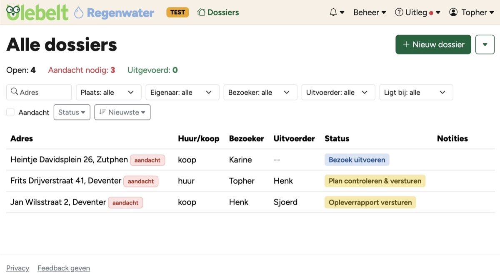

# Regenwater

**Een gratis, open-source app voor regenwaterprojecten in de buurt.** Vrijwilligers bezoeken woningen, maken een plan om regenpijpen af te koppelen van het riool, en plaatsen regentonnen. De app volgt elke woning van aanmelding tot oplevering, en regelt het papierwerk.

Gemaakt door en voor [De Ulebelt](https://ulebelt.nl/) in Deventer. Bedoeld voor gebruik op je telefoon, in iemands achtertuin.



## Wat de app doet

- **Eén dossier per woning**, van aanmelding tot uitvoering. Je ziet altijd bij welke stap elke woning is, en welke woningen aandacht nodig hebben.
- **Zoekt dingen voor je op**: vul een adres in en je krijgt de kadastrale kaart, een luchtfoto en het boorprofiel. In Deventer, Raalte en Olst-Wijhe vindt de app ook op welk soort riool het huis zit.
- **Werkt in de tuin**: formulieren slaan zichzelf op terwijl je typt, je kunt op foto's tekenen, en foto's die je zonder bereik maakt worden verstuurd zodra er weer verbinding is.
- **Rekent voor je**: de waterberging per regenpijp, en een materiaallijst met kostenraming.
- **Regelt het papierwerk**: het Plan van Aanpak en het opleverrapport als pdf, en e-mails aan bewoners en woningcorporaties vanuit sjablonen die je zelf schrijft.
- **Eenvoudig voor vrijwilligers**: geen wachtwoord om te onthouden, alleen een inloglink per e-mail. Beheerders verdelen de bezoeken en klussen.
- **Zorgvuldig met privacy**: gebouwd voor de AVG, met je gegevens op je eigen server in de EU.

## Gebruiken in jouw buurt

Je mag de app gratis gebruiken en aanpassen onder de EUPL-licentie. Voor een eigen versie heb je een kleine gehuurde server nodig (een paar euro per maand), een domeinnaam, en iemand die een middag met de opdrachtregel uit de voeten kan. **[Je eigen versie draaien](docs/run-your-own.md)** loopt alle stappen met je door.

Vragen of ideeën? [Maak een issue aan](https://github.com/ulebelt-deventer/regenwater/issues).

## Voor ontwikkelaars

Alles in TypeScript: een Hono-server op Node 26, SQLite via `better-sqlite3` (gewone SQL-migraties die bij het opstarten draaien), een SolidJS + Bootstrap 5 SPA gebouwd met Vite, en Chromium via Playwright voor de pdf's. De code staat in `src/server`, `src/client` en `src/shared` (velddefinities en statusregels die beide kanten gebruiken).

### Snel aan de slag

Nodig: Node 26 (`nvm use` leest `.nvmrc`).

```sh
npm install
npx playwright install chromium   # nodig voor de pdf's en de e2e-tests

# Maak jezelf beheerder (maakt data/app.db aan en draait zo nodig de migraties)
npm run beheerder -- "Je Naam" jij@example.org

npm start   # hetzelfde als npm run dev
```

Open daarna http://localhost:7425 en log in met dat e-mailadres. **In ontwikkeling wordt geen mail verstuurd.** Elke e-mail wordt weggeschreven naar `tmp/emails/*.html`, en de server print een regel `email sent to ..., view at: <pad>`. Open dat bestand voor de inlogcode of -link.

Goed om te weten:

- `npm start` / `npm run dev` start de Vite-client op 7425 (die `/api`, `/docs` en `/health` doorstuurt) en de API-server op 3000, en bouwt en herstart de server bij elke wijziging. Gebruik de URL met 7425 (de server print hem ook bij het opstarten); inloglinks wijzen daarheen. Productie gebruikt geen `npm start`: de systemd-unit draait `node dist/server/main.js`.
- Gegevens staan in `data/` (staat in .gitignore): `app.db` en `fotos/`. Verwijder de map om opnieuw te beginnen, en maak jezelf daarna weer beheerder. Met `DATA_DIR=...` gebruiken de server en het seed-commando een andere map.
- `npm run beheerder` bouwt eerst de serverbundel, dus draai het vóór `npm start` (anders herstart de dev-server één keer). Het geeft een fout als het e-mailadres al bestaat. Andere gebruikers voeg je toe op de pagina Gebruikers in de app.
- De inschrijving haalt live gegevens op bij PDOK, BRO en DINOloket, en heeft dus internet nodig.

### Tests en controles

```sh
npm run typecheck
npm run lint
npm run test:vite   # Vitest-unittests
npm run test:e2e    # bouwt, en draait dan de Playwright-scenario's
npm test            # beide
```

### Documentatie

De documentatie hieronder is in het Engels.

- `docs/spec.md`: specificatie van de schermen en de werkwijze, pagina voor pagina.
- `docs/architecture.md`: stack, opslag, e-mail, foto's, pdf's, monitoring en back-ups.
- `docs/berekening.md`: hoe de waterberging per regenpijp wordt berekend.
- `docs/privacy.md`: persoonsgegevens, verwerkers en de AVG.
- `docs/run-your-own.md`: je eigen productieversie opzetten, van begin tot eind.
- `devops/README.md`: naslag voor de VPS-inrichting, deploys en beheer.

## Licentie

Copyright 2026 De Ulebelt (https://ulebelt.nl/, Deventer). De code valt onder de EUPL-1.2; zie `LICENSE`. De naam en het logo van De Ulebelt vallen niet onder die licentie: vraag ons eerst of je ze mag gebruiken.
